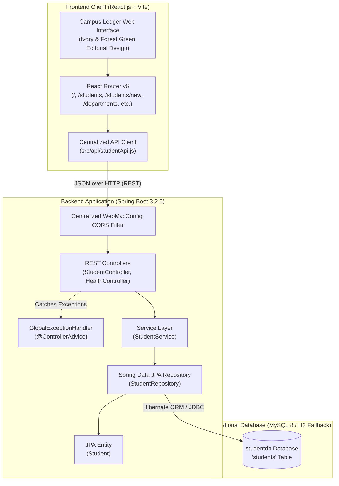

# Campus Ledger — System Architecture & Design Specification

## 1. System Overview

**Campus Ledger** is an academic Student Record Management System designed for a Semester III Full Stack Java Programming Lab assignment (A. P. Shah Institute of Technology / APSIT, Mini Project FSJP Lab).

The system integrates a **React 18** client, a **Spring Boot 3** layered REST API service, and a relational **MySQL 8** database via **Spring Data JPA**.



---

## 2. Layered Backend Architecture

The backend follows conventional Spring Boot layered architecture:

```
com.example.studentmanagement/
├── StudentManagementApplication.java  (Main bootstrap class)
├── controller/
│   ├── StudentController.java         (REST endpoints for CRUD & departments)
│   └── HealthController.java          (Live service & database telemetry endpoint)
├── service/
│   └── StudentService.java            (Transactional business logic & validation)
├── repository/
│   └── StudentRepository.java         (Spring Data JPA repository & queries)
├── entity/
│   └── Student.java                   (JPA Entity mapped to 'students' table)
├── dto/
│   ├── StudentRequest.java            (Input DTO with Jakarta Bean Validation)
│   ├── StudentResponse.java           (Output projection DTO)
│   ├── DepartmentSummary.java         (Aggregated department count DTO)
│   └── HealthResponse.java            (Service and DB status DTO)
├── exception/
│   ├── ResourceNotFoundException.java (404 Custom Exception)
│   ├── ErrorResponse.java             (Structured RFC 7807-compliant JSON error)
│   └── GlobalExceptionHandler.java    (@ControllerAdvice for centralized error mapping)
└── config/
    ├── WebMvcConfig.java              (Centralized CORS configuration)
    └── DataInitializer.java          (Development seed data runner)
```

---

## 3. Database Schema

- **Database Name:** `studentdb`
- **Main Table:** `students`

```sql
CREATE DATABASE IF NOT EXISTS studentdb;
USE studentdb;

CREATE TABLE IF NOT EXISTS students (
    id BIGINT PRIMARY KEY AUTO_INCREMENT,
    name VARCHAR(100) NOT NULL,
    email VARCHAR(100) NOT NULL,
    department VARCHAR(100) NOT NULL,
    created_at TIMESTAMP DEFAULT CURRENT_TIMESTAMP
);
```

### Entity to Table Mapping

| Java Field | Type | SQL Column | Nullable | Constraints |
|---|---|---|---|---|
| `id` | `Long` | `id` | NO | Primary Key, Auto Increment |
| `name` | `String` | `name` | NO | VARCHAR(100), `@NotBlank`, `@Size(2..100)` |
| `email` | `String` | `email` | NO | VARCHAR(100), `@NotBlank`, `@Email` |
| `department` | `String` | `department` | NO | VARCHAR(100), `@NotBlank`, `@Size(2..100)` |

---

## 4. RESTful API Contract

| HTTP Method | Route | Request Body | Response Code | Description |
|---|---|---|---|---|
| `GET` | `/api/health` | None | `200 OK` | Health diagnostics (service status, DB connectivity, uptime) |
| `GET` | `/api/students` | None | `200 OK` | Returns array of all student records |
| `GET` | `/api/students/{id}` | None | `200 OK` or `404 Not Found` | Returns single student record by primary key |
| `POST` | `/api/students` | `StudentRequest` (JSON) | `201 Created` or `400 Bad Request` | Enrolls new student record into database |
| `PUT` | `/api/students/{id}` | `StudentRequest` (JSON) | `200 OK` or `404 Not Found` | Updates existing student record |
| `DELETE` | `/api/students/{id}` | None | `204 No Content` or `404 Not Found` | Permanently deletes student record |
| `GET` | `/api/departments` | None | `200 OK` | Department-wise aggregated counts |

---

## 5. Frontend Architecture & Design Philosophy

The user interface rejects generic AI dashboard tropes (no neon gradients, glassmorphism, or oversized decorative widgets) in favor of an **editorial-style university administration interface**:

- **Color Palette:**
  - Main background: Warm ivory (`#F7F6F0`)
  - Primary surface: Crisp white (`#FFFFFF`)
  - Typography: Deep charcoal text (`#242923`) with subdued gray-green accents (`#5A6B5E`)
  - Brand accents: Deep forest green (`#355C46`) for primary CTAs and muted terracotta (`#B66B50`) for destructive/warning actions.
  - Borders: Warm subtle gray (`#E4E3DB`).
- **Typography:** Refined serif headings (`Instrument Serif` / Georgia) paired with legible sans-serif body typography (`Plus Jakarta Sans`).
- **Responsive Layout:** Sticky sidebar on desktop; off-canvas sliding navigation drawer on tablet and mobile.
- **Defensive Error Handling:** All API calls route through `studentApi.js` with structured error handling, visual toast notifications, and retry buttons on failed states.
