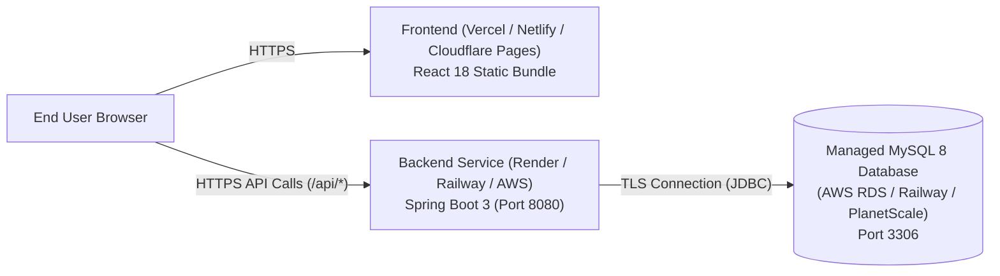

# Campus Ledger — Production Deployment Guide

This document outlines the deployment strategy for **Campus Ledger** (Student Record Management System) across modern cloud infrastructure.

---

## 1. Cloud Architecture Overview

Campus Ledger is decoupled into three cloud tiers:

1. **Static Frontend Tier:** Hosted on Vercel, Netlify, Cloudflare Pages, or AWS S3 + CloudFront.
2. **Spring Boot Backend Tier:** Hosted on Render, Railway, AWS App Runner, Fly.io, or Heroku.
3. **Managed MySQL Database Tier:** Hosted on AWS RDS for MySQL, PlanetScale, Railway MySQL, or Aiven.



---

## 2. Environment Variables Configuration

### A. Frontend Environment (`frontend/.env.production`)

Set in your hosting provider's build dashboard (e.g., Vercel / Netlify Environment Variables):

```env
VITE_API_BASE_URL=https://campus-ledger-api.yourdomain.com
```

> **Warning:** Do not use `localhost` or hardcode HTTP origins in production.

### B. Backend Environment (`backend`)

Set in your container/cloud service provider (e.g., Render, Railway, AWS ECS):

```env
# Server Port assigned dynamically by the host
PORT=8080

# Cloud MySQL Connection URL
DB_URL=jdbc:mysql://your-cloud-db-host:3306/studentdb?useSSL=true&requireSSL=true&serverTimezone=UTC

# Database Credentials (use secret manager)
DB_USERNAME=admin
DB_PASSWORD=your_secure_cloud_db_password

# CORS allowed frontend origin (no trailing slash)
CORS_ALLOWED_ORIGINS=https://campus-ledger.yourdomain.com,https://your-preview-domain.vercel.app

# Enable production profile
SPRING_PROFILES_ACTIVE=prod
```

---

## 3. Build & Packaging Instructions

### Packaging Backend (JAR)
Run inside the `backend` directory:
```bash
mvn clean package -DskipTests
```
This generates:
```
target/studentmanagement-0.0.1-SNAPSHOT.jar
```
Start Command on Cloud Host:
```bash
java -jar target/studentmanagement-0.0.1-SNAPSHOT.jar --spring.profiles.active=prod
```

### Packaging Frontend (Static Bundle)
Run inside the `frontend` directory:
```bash
npm run build
```
This outputs the static build in:
```
frontend/dist/
```

---

## 4. Platform-Specific Deployment Guides

### Option A: Railway (One-Click Monorepo Support)
1. Link your Git repository on [Railway](https://railway.app/).
2. Add a **MySQL** plugin service; note the database connection URL and credentials.
3. Deploy the backend service:
   - Root directory: `backend`
   - Build command: `mvn clean package -DskipTests`
   - Start command: `java -jar target/studentmanagement-0.0.1-SNAPSHOT.jar --spring.profiles.active=prod`
   - Add environment variables (`DB_URL`, `DB_USERNAME`, `DB_PASSWORD`, `CORS_ALLOWED_ORIGINS`).
4. Deploy the frontend service:
   - Root directory: `frontend`
   - Build command: `npm run build`
   - Output directory: `dist`
   - Add environment variable `VITE_API_BASE_URL` with your Railway backend domain.

### Option B: Render.com
1. Create a **MySQL / PostgreSQL** instance or connect an external managed MySQL database.
2. Create a **Web Service** for the backend:
   - Environment: `Java` or `Docker`
   - Build command: `cd backend && mvn clean package -DskipTests`
   - Start command: `cd backend && java -jar target/studentmanagement-0.0.1-SNAPSHOT.jar --spring.profiles.active=prod`
3. Create a **Static Site** for the frontend:
   - Build command: `cd frontend && npm install && npm run build`
   - Publish directory: `frontend/dist`
   - Rewrite rule for client-side routing: Source `/*` -> Destination `/index.html`.

---

## 5. Security & Production Best Practices

1. **Controlled Database Migrations:**
   In production (`application-prod.properties`), `spring.jpa.hibernate.ddl-auto=validate` is configured instead of `update`, preventing accidental alterations or column drops.
2. **Strict CORS Policy:**
   Centralized CORS (`WebMvcConfig.java`) restricts browser requests strictly to authorized origins provided in `CORS_ALLOWED_ORIGINS`.
3. **Transport Layer Security (HTTPS / TLS):**
   Ensure both frontend and backend use valid SSL certificates (`https://`). Force `useSSL=true` on MySQL JDBC connection strings.
4. **Secret Management:**
   Never commit `.env` or production passwords to git repositories. Always use cloud platform environment secret stores.

---

## 6. Post-Deployment Verification Checklist

- [ ] Backend health endpoint (`https://api.domain.com/api/health`) reports `{"status":"UP","databaseConnected":true}`.
- [ ] Database contains initial schema from `database/schema.sql`.
- [ ] Adding a student through the deployed web UI returns HTTP 201 and updates the directory table.
- [ ] Refreshing the browser on `/students` or `/students/1` maintains client-side route without 404 (handled by static server rewrite to `index.html`).
- [ ] Editing student records persists to MySQL across server reboots.
- [ ] Deleting a student confirms through modal dialog and removes the record from the database.
- [ ] Department breakdown card displays real-time aggregated counts.
